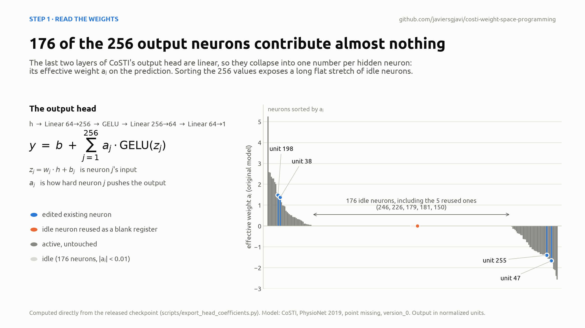
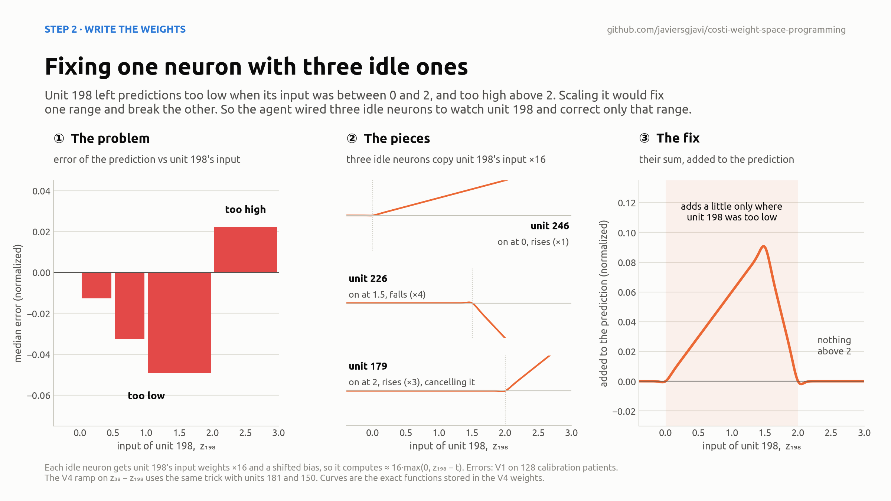
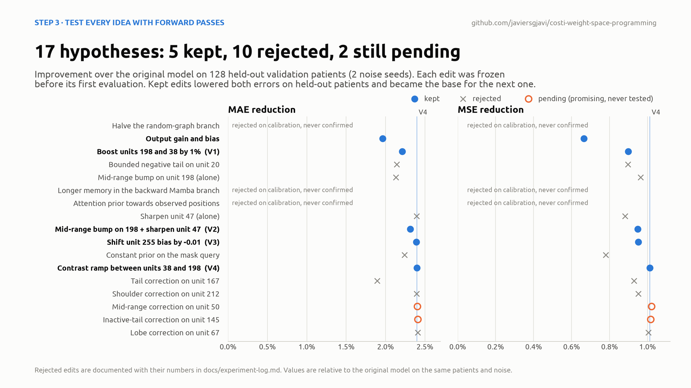
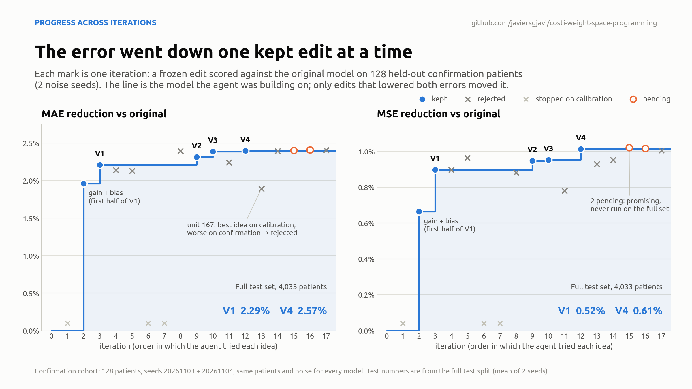
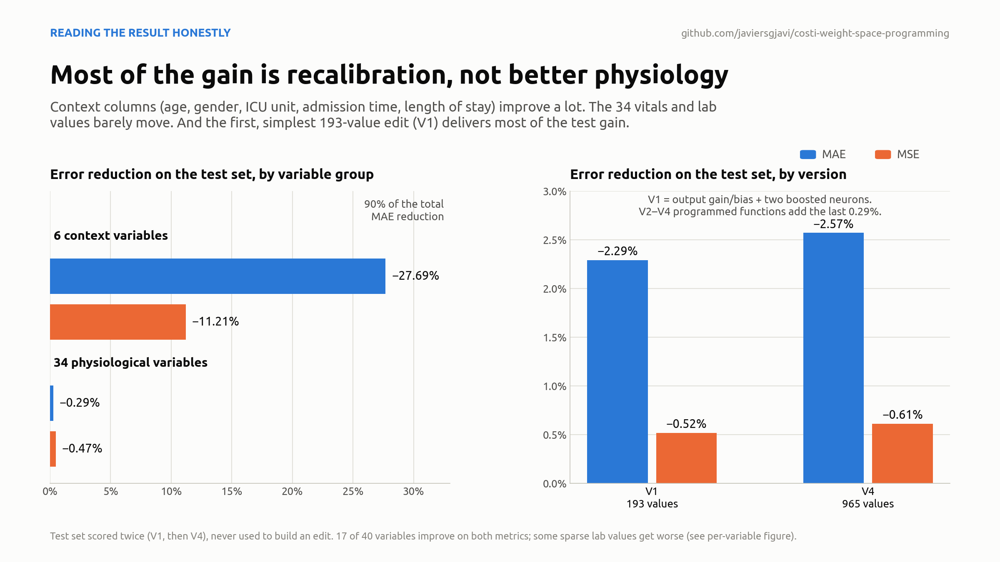
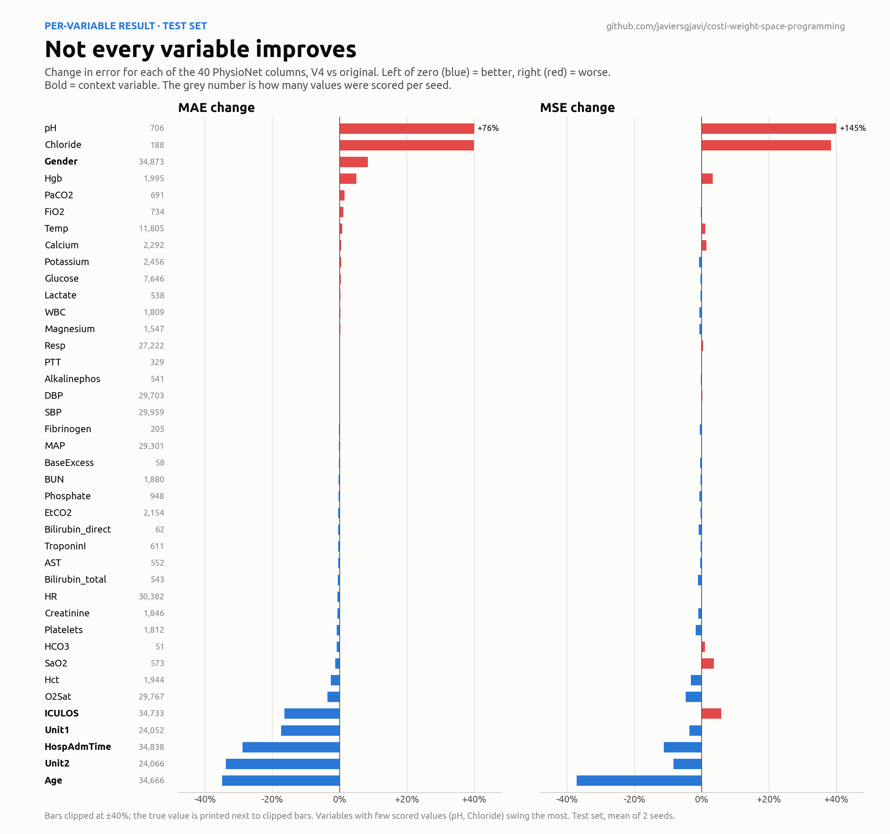

Two days ago, Rikiya Takehi, Jayden Teoh, Alex Zhang and Omar Khattab (MIT CSAIL) published [*Sparks of Weight-Space Programming*](https://rikiyat.github.io/blog/weight-space-programming/). Their claim is that a language model can **read the weights of a neural network, work out what they compute, and write new weights that fix a problem**, with no training at all.

I had to try it on a model I know inside out: **CoSTI**, the time-series imputation model I built during my PhD. So I opened a terminal, gave a coding agent (Astra 6 Max, running in OpenAI Codex) the blog post, the CoSTI repository and the released checkpoints, and set three rules:

1. Follow the weight-space-programming approach.
2. No gradient-based training of any kind.
3. An edit only counts if it lowers **both** MAE and MSE.

About thirteen hours later, the agent had rewritten **965 of CoSTI's 2.4 million weights** (0.04%). On the full test set, MAE went down 2.57% and MSE 0.61%.

This post explains what it did, why I think the way it did it is the interesting part, and why the numbers deserve some caution.

> Everything is public: code, every edit recipe, the evidence files, the figures and the full session transcript. You can find all of it in [**javiersgjavi/costi-weight-space-programming**](https://github.com/javiersgjavi/costi-weight-space-programming).
{: .prompt-info }

**Table of contents**

* Contents
{:toc}

## What weight-space programming is

When we want a trained network to behave differently, we normally retrain or fine-tune it. An optimizer like Adam nudges every weight a little, guided by gradients, and nobody looks at what each weight means.

Weight-space programming does something else. A language model:

1. **reads** the weights and figures out what each part computes,
2. **diagnoses** a concrete failure,
3. **writes** an explicit edit that a person can read,
4. **checks** it with forward passes only.

There is no backpropagation anywhere in the loop. In the original post the authors use it on RL policies, small diffusion models, a Go network and Qwen3.5-0.8B. I wanted to see whether it also worked on a real research model, on its own benchmark, against its own released checkpoint.

## The model and the task

[CoSTI](https://github.com/javiersgjavi/CoSTI) is a **consistency model for spatio-temporal imputation**, published in *Knowledge-Based Systems* in 2025. Imputation means filling in missing values. Hospital records, for example, have heart rate every hour, some lab values once a day and others never. A good imputer estimates the gaps from how each variable evolves and how the variables relate to each other.

Consistency models are what makes CoSTI fast. A diffusion model removes noise in hundreds of small steps. A consistency model learns to jump straight back to clean data in one or two.

The agent worked on **PhysioNet Challenge 2019**: 48-hour windows of 40 ICU variables per patient. 25% of the observed values are hidden at random, the model fills them in, and MAE and MSE are measured on those hidden values. Each patient is imputed with 2 denoising steps and 100 samples, and the median of the samples is the answer.

## Step 1: read the weights

After auditing the released checkpoints, the agent focused on the **output head**, the last block of the network, which turns a 64-number internal representation into the predicted value:

```
h (64) ─► Linear 64→256 ─► GELU ─► Linear 256→64 ─► Linear 64→1 ─► y
```

The last two layers are linear with nothing between them, so they collapse into one. That makes the whole head exactly equal to

```
y = b + Σⱼ aⱼ · GELU(zⱼ)
```

Each of the 256 hidden neurons has an input `zⱼ` and **a single effective weight `aⱼ`**, which says how much that neuron pushes the prediction up or down. Written this way, the head reads almost like code.

{: width="2400" height="1350" }
_176 of the 256 neurons contribute almost nothing to the output._

Two things came straight out of the weights:

- **176 of the 256 neurons are idle.** Their effective weight is below 0.01 in absolute value, so training left them practically disconnected. That is free space.
- **A handful of neurons carry the output.** Units 198 and 38 push it up strongly, and units 47 and 255 push it down.

The agent then ran the model on calibration patients (validation data, never the test set), recorded what every neuron did, and compared it with the errors. It found that the output was slightly compressed and shifted, and that some neurons left systematic errors in specific ranges of their input. For example, unit 198 underestimated when its input was between 0 and 2.

## Step 2: write the weights

Each diagnosis became one explicit edit, with its coefficients **fixed before it was ever evaluated**. Nothing was fitted to data.

The simplest edits were plain arithmetic: scale the output by 1.005, shift it by −0.012, and make units 198 and 38 1% stronger. That is version V1, which changes 193 values.

The trick I liked most is how it **built new functions out of idle neurons**. It rests on four facts.

**Idle neurons are free space.** Each neuron adds `aⱼ · GELU(zⱼ)` to the output. The 176 idle neurons have `aⱼ ≈ 0`, so whatever they compute never reaches the prediction. Their input weights, bias and output weight can be overwritten without changing anything the model already did, much like reusing unused variables in a program.

**A steep GELU is a switch.** GELU(x) is close to 0 for negative x and close to x for positive x, with a smooth bend around 0. Multiply its input by 16 and the bend gets 16 times sharper. In practice it becomes a ReLU, with a clean kink at 0.

**An idle neuron can watch another neuron.** To make idle unit 246 switch on when unit 198's input crosses a threshold `t`, the agent set

```text
input weights of 246  =  16 · input weights of 198
bias of 246           =  16 · (bias of 198 − t)
```

so that `z₂₄₆ = 16 · (z₁₉₈ − t)`. Unit 246 now stays at zero while `z₁₉₈ < t` and grows in a straight line above it. Its output weight, kept small, sets how steep that ramp is in the final prediction.

**Adding ramps draws shapes.** Each reused neuron contributes a ramp that starts at its own threshold, and a sum of ramps can draw any shape made of straight segments. The bump on unit 198 uses three:

| Neuron | Switches on at `z₁₉₈ =` | Relative output weight | Slope of the sum after that point |
|---|---:|---:|---|
| 246 | 0 | +1 | +1: starts rising |
| 226 | 1.5 | −4 | +1 − 4 = −3: falls |
| 179 | 2 | +3 | −3 + 3 = 0: flat, switched off |

The result is a small triangle: it adds a little to the prediction (at most about 0.09 in normalized units) while `z₁₉₈` is between 0 and 2, peaks at 1.5, and adds nothing anywhere else. It is the orange curve in the right panel of the figure below.

**Why not just scale unit 198?** The diagnosis said unit 198 left predictions too low for `z₁₉₈` between 0 and 2, but too high above 2. Raising its output weight would fix the first range and make the second worse. The bump acts only where the error was. It is as if the agent had added `if 0 < z₁₉₈ < 2: add a little` to the model, written directly into its weights.

**The ramp uses the same trick on a difference.** Units 181 and 150 copy `64 · (input weights of 38 − input weights of 198)`, so they watch `d = z₃₈ − z₁₉₈`. The first switches on at `d = 0` and the second cancels it at `d = 1`, which gives `0.070 · clip(d, 0, 1)`. Normally `z₃₈ < z₁₉₈`, so the ramp only acts in the rare cases where unit 38 overtakes 198.

{: width="2400" height="1350" }
_Left: the problem in unit 198. Middle: the three idle neurons. Right: their sum, the exact correction stored in the final weights._

The final model, V4, combines six edits like these: 965 values in 5 tensors, all of them in the output head. I can read every one of them in a JSON file and explain what it does.

## Step 3: test every idea, and throw most of them away

This is the part I didn't expect. The agent designed a protocol that a lucky edit could not easily get through:

- It split the validation patients into **calibration**, used to look at activations and design edits, and **confirmation**, used only to accept or reject a frozen edit. The **test set** was kept for the end.
- Every recipe was **written, hashed and frozen** before its first forward pass.
- Original and edited models always saw **the same patients, masks and noise**, so any difference came from the weights.
- At my request, an edit had to improve **both** metrics on confirmation to be kept.

Most ideas failed. Out of 17 hypotheses, 5 were kept, 10 rejected and 2 were still pending when I stopped.

{: width="2400" height="1350" }

Seen in order, the search looks like a staircase. The accepted model only moves when an edit passes, and most iterations leave it where it was:

{: width="2400" height="1350" }
_The error went down one kept edit at a time._

Two cases show why the protocol matters:

- Two edits, **a bump on unit 198 and a sharper unit 47**, each failed alone: one helped MSE but hurt MAE, the other the opposite. **Combined, they improved both**, and became V2.
- **A correction on unit 167 was the best idea of all on calibration**, then lost on confirmation patients. It was rejected. Without a separate confirmation set it would have made it into the final model.

## Results

On the full test set (4,033 patients, 100 samples each, 2 noise seeds), against my own run of the released checkpoint under exactly the same protocol:

| | Values changed | MAE | MSE |
|---|---:|---:|---:|
| CoSTI, original checkpoint | 0 | 2.4810 | 350.12 |
| V1 (recalibration + 2 neurons) | 193 | 2.4241 (−2.29%) | 348.31 (−0.52%) |
| **V4 (final)** | **965** | **2.4172 (−2.57%)** | **347.98 (−0.61%)** |

The 95% interval for the per-patient change excludes zero for both metrics, and both improve on each seed separately.

## How much does this really mean?

It's a real improvement, measured carefully, but it's easy to oversell. These are the caveats I think matter most:

{: width="2400" height="1350" }

- **Most of the MAE gain comes from easy columns.** Six of the 40 variables are context: age, gender, ICU unit, admission time and length of stay. They account for 90% of the MAE reduction. On the 34 vitals and lab values, the improvement is only 0.29% MAE and 0.47% MSE.
- **The simplest edit did most of the work.** V1, little more than recalibrating the output, already gives −2.29% MAE. The programmed functions add the last 0.29%.
- **Not every variable improves.** 17 of the 40 improve on both metrics, and some sparse lab values, like pH, get clearly worse (see the figure below).
- **The test set was scored twice, though never used to build anything.** The agent evaluated V1 on test when it was meant to be the final result, then kept searching and evaluated V4 on the same test. Every edit was designed on calibration patients, accepted on confirmation patients and frozen before its test run, so no test data went into any edit. Still, the reported number is in practice the better of two tested versions. That mostly affects V4's small margin over V1; the gain over the original is well outside the noise. Scoring the frozen V4 on data nobody has evaluated yet would be the proper confirmation.
- **One checkpoint, one benchmark.** In the paper we report the average of five trained models. This is one of them, so these numbers are not comparable with the paper's.
- **It explains functions, not medicine.** I know exactly what function each edit adds to the head. I don't know what clinical concept a neuron stands for, and probably none maps cleanly to one.

{: width="2400" height="2250" }
_Per-variable change on the test set. Blue is better, red is worse._

## What didn't work

The agent also tried editing the deeper parts of CoSTI, where the representation is built rather than read out: the Mamba temporal memory, the attention, and the graph between variables. **None of those edits improved both metrics.**

One reason is that CoSTI denoises in two steps. A change in the first step changes the input of the second, and can change which of the 100 samples ends up as the median. An edit that looks local can act globally.

There was also a side finding, a little embarrassing for me as the author. CoSTI's adaptive graph factors are not stored in the standard `state_dict`, so a reloaded checkpoint does not reproduce the trained graph exactly. The agent noticed, reconstructed them, and saved them explicitly in the exported model. It doesn't count towards the improvement, but it's the kind of thing you only find when someone reads the model this closely.

## What I take from this

The 2.57% is not what stays with me. I suspect a bit of fine-tuning could match it. What stays with me is what the process produced:

- **A readable edit.** Every change is a few lines of JSON with a reason attached. If something goes wrong, I know exactly what to undo.
- **A model that improved without training.** No gradients, no new data, no optimizer. Only forward passes to check each idea.
- **A rigorous protocol, mostly designed by the agent.** It froze its edits before evaluating them, kept data splits apart, and recorded its failures as carefully as its successes.

My part was setting the goal and the rules, choosing the checkpoint and deciding when to stop. The agent did the rest: it read the code and the weights, wrote the inference harness, diagnosed the model, wrote every edit and documented every failure. The full session, in Spanish and with my messages included, is in the [transcript](https://github.com/javiersgjavi/costi-weight-space-programming/tree/main/docs/transcript).

Three promising candidates were still in the queue when I shut the machine down, so this is probably not the ceiling.

## Links

- Study repository: [javiersgjavi/costi-weight-space-programming](https://github.com/javiersgjavi/costi-weight-space-programming)
- Method: R. Takehi, J. Teoh, A. Zhang, O. Khattab, [*Sparks of Weight-Space Programming*](https://rikiyat.github.io/blog/weight-space-programming/), MIT CSAIL, 2026.
- Model: J. Solís-García, B. Vega-Márquez, J. A. Nepomuceno, I. A. Nepomuceno-Chamorro, *CoSTI: Consistency models for (a faster) spatio-temporal imputation*, Knowledge-Based Systems 327, 114117 (2025). [doi:10.1016/j.knosys.2025.114117](https://doi.org/10.1016/j.knosys.2025.114117)
- Original code: [javiersgjavi/CoSTI](https://github.com/javiersgjavi/CoSTI)
